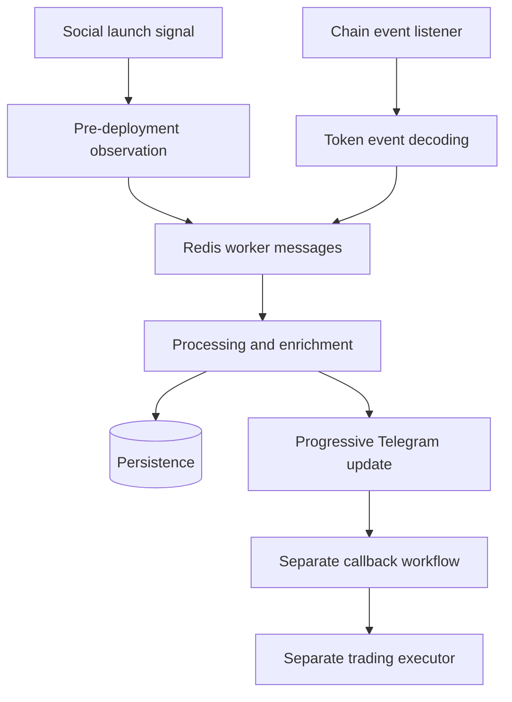

# Token Deployment Monitor

  [](LICENSE)

Connect social launch signals with on-chain token-deployment events and distribute progressively enriched observations through a worker-based system.

The source includes the earlier BANKR flow and CLAWNCH-oriented adaptation material. It also contains callback/trading components, so the overall repository is broader than a read-only alert listener.

## From pre-deployment signal to chain evidence



[CLAWNCH_ARCHITECTURE_GUIDE.md](CLAWNCH_ARCHITECTURE_GUIDE.md) describes the stages and their historical adaptation. [ONCHAIN_EVENT_STRUCTURE.md](ONCHAIN_EVENT_STRUCTURE.md) documents event shape; [REDIS_DATA_GUIDE.md](REDIS_DATA_GUIDE.md) explains retained/message data. Worker implementations are under [workers](workers), with shared code under [shared](shared).

## Inspect the service composition first

[docker-compose.yml](docker-compose.yml) declares Redis/PostgreSQL infrastructure and source/listener/processor services. Starting all services can enable network collection, notifications and execution-related components; it is not a suitable documentation smoke test.

```console
python -m venv .venv
python -m pip install -r requirements.txt
python -m compileall -q config shared workers src
```

This checks source syntax only. Provider APIs, RPC/WebSocket readers, storage, bot destinations and any execution authorization must be configured separately through the declared inputs. Replace example/local development defaults and keep real credentials outside Git.

## What the snapshot establishes

The repository exposes the listener→processor→distribution architecture and its implementation history. Historical forensic guides and sample exports are not current provider validation. No end-to-end deployment or live purchase is established by the compilation command, and a candidate deployment signal is not a settled trade.

**Technology:** Python · Web3.py · eth-abi · aiohttp · Redis · SQLite paths · Docker

Project-authored source: [MIT](LICENSE). Third-party components retain their own notices and terms.
