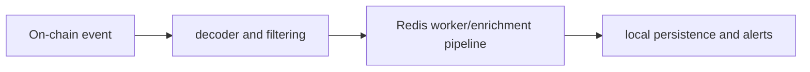

# Token Deployment Monitor

**Decode deployment events, enrich observations and distribute worker results.**

  [](LICENSE)

[Overview](#overview) · [Quickstart](#quickstart) · [Example](#example) · [Validation](#validation) · [Documentation](#documentation)

## Overview

A Python event-processing toolkit for inspecting token deployments, enriching observations and distributing alerts.

**Stack:** Python · Web3.py · eth-abi · aiohttp · Redis · SQLite paths · Docker

## From chain event to enriched observation

| Component | Behavior |
| --- | --- |
| Decode | Event/block-range collection identifies token deployment observations. |
| Enrich | Workers add token/social metadata across separate stages. |
| Distribute | Redis, persistence and messaging paths route summarized results. |

## Processing path



## Quickstart

```console
python -m venv .venv
# Activate .venv, then:
python -m pip install -r requirements.txt
python -m compileall -q config
```

The commands above install prerequisites or run the specified offline checks. Live collection, cloud operations, messaging and trading are separate operational steps when present.

## Example

**Inspect the workflow**

Read the Compose services and [architecture guide](CLAWNCH_ARCHITECTURE_GUIDE.md) to distinguish collection, enrichment and distribution. Trace an observation through its worker boundary before enabling a live process. The quickstart checks configuration-module syntax only; it is not a functional pipeline test.

## Configuration and storage

Web3.py, ABI decoding, aiohttp and Redis support event processing. [.env.example](.env.example) lists source, messaging and storage configuration. Local SQLite/file paths coexist with broader deployment storage settings.

## Repository guide

| Location | Responsibility |
| --- | --- |
| [config](config) | Configuration modules |
| [docker-compose.yml](docker-compose.yml) | Service boundaries |
| [CLAWNCH_ARCHITECTURE_GUIDE.md](CLAWNCH_ARCHITECTURE_GUIDE.md) | Worker architecture |
| [CLAWNCH_WORKER_FORENSIC.md](CLAWNCH_WORKER_FORENSIC.md) | Worker investigation notes |

## Validation

The quickstart lists the declared checks. No passing CI or coverage claim is implied by the technology badges.

## Scope and operational boundaries

A trading executor is also present, so the full stack is not read-only. Worker startup, messages and transaction execution are separate operations. Historical datasets and external SDK copies are outside the documented demonstration.

## Documentation

- The repository guide above links directly to the implementation and configuration files.

## License and attribution

Project-authored source code is licensed under the [MIT License](LICENSE). Third-party components and datasets retain their respective rights and licenses.
