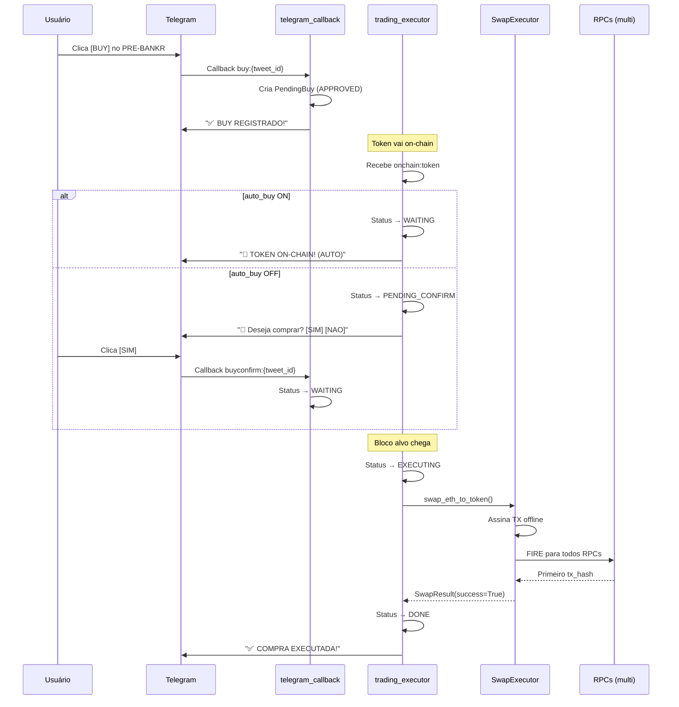

# Auto-Buy Logic & Swap Execution

**Última atualização:** Janeiro 2026  
**Versão:** 2.0 (Docker Workers + Uniswap V4)

---

## Índice

1. [Visão Geral](#visão-geral)
2. [Fluxo Completo](#fluxo-completo)
3. [Status do PendingBuy](#status-do-pendingbuy)
4. [Auto-buy ON vs OFF](#auto-buy-on-vs-off)
5. [Swap Executor (Uniswap V4)](#swap-executor-uniswap-v4)
6. [Multi-RPC Fire Pattern](#multi-rpc-fire-pattern)
7. [Contratos e Endereços](#contratos-e-endereços)
8. [Arquivos Relevantes](#arquivos-relevantes)
9. [Configurações](#configurações)
10. [Logs Esperados](#logs-esperados)

---

## Visão Geral

O sistema de Auto-Buy permite aos usuários:
1. **Clicar em "Buy"** em uma mensagem PRE-BANKR
2. **Aguardar** o token ir on-chain
3. **Executar automaticamente** (auto-buy ON) ou **confirmar manualmente** (auto-buy OFF)
4. **Swap ultra-rápido** via Uniswap V4 com multi-RPC fire

### Princípio Fundamental

```
❌ ERRADO: Comprar TUDO automaticamente quando auto-buy está ON
✅ CORRETO: Só comprar tokens que o usuário clicou em "Buy"
```

---

## Fluxo Completo

```
┌─────────────────────────────────────────────────────────────────────┐
│                         FASE 1: PRE-BANKR                           │
└─────────────────────────────────────────────────────────────────────┘
                                    │
                                    ▼
┌─────────────────────────────────────────────────────────────────────┐
│  PRE-BANKR aparece no Telegram                                      │
│                                                                     │
│  🟢 NEW PRE BANKR                                                   │
│  Token: ExampleToken ($EXAMPLE)                                     │
│  From: @creator                                                     │
│                                                                     │
│  [Tweet] [From] [❤️ Like] [💰 BUY]                                  │
└─────────────────────────────────────────────────────────────────────┘
                                    │
                    Usuário clica em [💰 BUY]
                                    │
                                    ▼
┌─────────────────────────────────────────────────────────────────────┐
│  telegram_callback._handle_buy_click()                              │
│                                                                     │
│  1. Verifica se wallet está configurada                             │
│  2. Verifica se já existe PendingBuy para este token                │
│  3. Cria PendingBuy com status = "APPROVED"                         │
│  4. Publica evento: trading:buy_approved                            │
│                                                                     │
│  ✅ BUY REGISTRADO!                                                 │
│  Token: ExampleToken                                                │
│  ETH: 0.01                                                          │
│  Bloco: +6 (16.7% fee)                                              │
│  Modo: 🟢 AUTO (ou 🟡 MANUAL)                                       │
│                                                                     │
│  ⏳ Aguardando token ir on-chain...                                 │
└─────────────────────────────────────────────────────────────────────┘
                                    │
                                    ▼
┌─────────────────────────────────────────────────────────────────────┐
│                         FASE 2: ON-CHAIN                            │
└─────────────────────────────────────────────────────────────────────┘
                                    │
        Token é criado on-chain (onchain:token event)
                                    │
                                    ▼
┌─────────────────────────────────────────────────────────────────────┐
│  trading_executor._handle_token()                                   │
│                                                                     │
│  1. Recebe evento onchain:token com token_address                   │
│  2. Busca todos os PendingBuys para este tweet_id                   │
│  3. Para cada PendingBuy:                                           │
│     a. Link com token (endereço, pool_id, etc)                      │
│     b. Calcula target_block = auction_expire + block_offset         │
│     c. VERIFICA config.auto_buy do usuário                          │
└─────────────────────────────────────────────────────────────────────┘
                                    │
                    ┌───────────────┴───────────────┐
                    │                               │
            auto_buy = ON                   auto_buy = OFF
                    │                               │
                    ▼                               ▼
┌─────────────────────────────┐   ┌─────────────────────────────────┐
│ Status → WAITING            │   │ Status → PENDING_CONFIRM        │
│                             │   │                                 │
│ 🚀 TOKEN ON-CHAIN!          │   │ 🔔 TOKEN ON-CHAIN!              │
│                             │   │                                 │
│ Compra agendada (AUTO):     │   │ Deseja executar a compra?       │
│ Bloco: 12345 (+6)           │   │                                 │
│ Fee: 16.7%                  │   │ [✅ SIM, COMPRAR!] [❌ Cancelar] │
│                             │   │                                 │
│ ⏳ Aguardando bloco alvo... │   │                                 │
└─────────────────────────────┘   └─────────────────────────────────┘
                    │                               │
                    │               Usuário clica [✅ SIM]
                    │                               │
                    │                               ▼
                    │             ┌─────────────────────────────────┐
                    │             │ telegram_callback               │
                    │             │ ._handle_buy_confirm()          │
                    │             │                                 │
                    │             │ Status → WAITING                │
                    │             └─────────────────────────────────┘
                    │                               │
                    └───────────────┬───────────────┘
                                    │
                                    ▼
┌─────────────────────────────────────────────────────────────────────┐
│                       FASE 3: EXECUÇÃO                              │
└─────────────────────────────────────────────────────────────────────┘
                                    │
            Bloco alvo (target_block) chega
                                    │
                                    ▼
┌─────────────────────────────────────────────────────────────────────┐
│  trading_executor._handle_block()                                   │
│                                                                     │
│  1. Recebe evento onchain:block                                     │
│  2. Busca todos os PendingBuys com:                                 │
│     - status = "WAITING"                                            │
│     - target_block <= current_block                                 │
│  3. Executa todos em PARALELO                                       │
└─────────────────────────────────────────────────────────────────────┘
                                    │
                                    ▼
┌─────────────────────────────────────────────────────────────────────┐
│  trading_executor._execute_trade()                                  │
│                                                                     │
│  1. Status → EXECUTING                                              │
│  2. Notifica usuário: "EXECUTANDO COMPRA..."                        │
│  3. Obtém wallet do usuário (private_key)                           │
│  4. Chama _execute_swap()                                           │
└─────────────────────────────────────────────────────────────────────┘
                                    │
                                    ▼
┌─────────────────────────────────────────────────────────────────────┐
│  SwapExecutor.swap_eth_to_token()                                   │
│                                                                     │
│  1. Monta transação Uniswap V4:                                     │
│     - WRAP_ETH (ETH → WETH)                                         │
│     - V4_SWAP (WETH → Token)                                        │
│  2. Assina transação offline                                        │
│  3. FIRE para todos os RPCs simultaneamente!                        │
│  4. Retorna primeiro tx_hash bem-sucedido                           │
└─────────────────────────────────────────────────────────────────────┘
                                    │
                    ┌───────────────┴───────────────┐
                    │                               │
               Sucesso ✅                      Falha ❌
                    │                               │
                    ▼                               ▼
┌─────────────────────────────┐   ┌─────────────────────────────────┐
│ Status → DONE               │   │ Status → FAILED                 │
│                             │   │                                 │
│ ✅ COMPRA EXECUTADA!        │   │ ❌ COMPRA FALHOU                │
│                             │   │                                 │
│ Token: ExampleToken         │   │ Erro: [mensagem]                │
│ ETH: 0.01                   │   │                                 │
│ TX: 0x123...                │   │                                 │
└─────────────────────────────┘   └─────────────────────────────────┘
```

---

## Status do PendingBuy

```
APPROVED ──────────────────────────────────────────────────────────►
    │                                                               │
    │ (token vai on-chain)                                          │
    │                                                               │
    ├── auto_buy ON ──► WAITING ──► (bloco chega) ──► EXECUTING     │
    │                                                      │        │
    │                                                      ▼        │
    │                                               DONE / FAILED   │
    │                                                               │
    └── auto_buy OFF ──► PENDING_CONFIRM                            │
                              │                                     │
                    (usuário confirma)                              │
                              │                                     │
                              ▼                                     │
                         WAITING ──────────────────────────────────►
```

### Descrição dos Status

| Status | Descrição |
|--------|-----------|
| `APPROVED` | Usuário clicou em BUY, aguardando token ir on-chain |
| `WAITING` | Token on-chain, aguardando bloco alvo para executar |
| `PENDING_CONFIRM` | Token on-chain, aguardando confirmação do usuário (auto_buy OFF) |
| `EXECUTING` | Swap está sendo executado |
| `DONE` | Compra executada com sucesso |
| `FAILED` | Compra falhou |
| `CANCELLED` | Usuário cancelou |

---

## Auto-buy ON vs OFF

### Auto-buy ON 🟢

```
PRE-BANKR → [BUY] → APPROVED → Token on-chain → WAITING → EXECUTAR
                                                    ▲
                                          (automático, sem perguntar)
```

**Comportamento:**
- Quando token vai on-chain, status muda para `WAITING`
- Sistema executa automaticamente no bloco alvo
- Usuário NÃO precisa confirmar

### Auto-buy OFF 🔴

```
PRE-BANKR → [BUY] → APPROVED → Token on-chain → PENDING_CONFIRM
                                                      │
                                              [SIM] [CANCELAR]
                                                      │
                                              WAITING → EXECUTAR
```

**Comportamento:**
- Quando token vai on-chain, status muda para `PENDING_CONFIRM`
- Sistema envia mensagem: "Deseja executar a compra?"
- Usuário deve clicar `[SIM, COMPRAR!]` para confirmar
- Após confirmação, status muda para `WAITING` e executa

---

## Swap Executor (Uniswap V4)

### Arquitetura

```
┌─────────────────────────────────────────────────────────────────────┐
│                      SwapExecutor                                   │
│                                                                     │
│  ┌─────────────────┐    ┌─────────────────┐    ┌────────────────┐  │
│  │  Private Key    │    │  RPC URLs       │    │  Gas Config    │  │
│  │  (from user)    │    │  (multi-fire)   │    │  (low for L2)  │  │
│  └─────────────────┘    └─────────────────┘    └────────────────┘  │
│                                                                     │
│  ┌─────────────────────────────────────────────────────────────┐   │
│  │                    swap_eth_to_token()                       │   │
│  │                                                              │   │
│  │  1. Build Universal Router calldata                          │   │
│  │     - WRAP_ETH (0x0b)                                        │   │
│  │     - V4_SWAP (0x10)                                         │   │
│  │                                                              │   │
│  │  2. Sign transaction offline (instant)                       │   │
│  │                                                              │   │
│  │  3. Fire to ALL RPCs simultaneously                          │   │
│  │     asyncio.gather(                                          │   │
│  │         send_to_ankr(),                                      │   │
│  │         send_to_alchemy(),                                   │   │
│  │         send_to_base(),                                      │   │
│  │         ...                                                  │   │
│  │     )                                                        │   │
│  │                                                              │   │
│  │  4. Return first successful tx_hash                          │   │
│  └─────────────────────────────────────────────────────────────┘   │
└─────────────────────────────────────────────────────────────────────┘
```

### Universal Router Commands

```python
# Commands usados no swap
CMD_WRAP_ETH = 0x0b      # Converte ETH → WETH
CMD_V4_SWAP = 0x10       # Executa swap no Uniswap V4

# Função execute()
execute(
    bytes commands,      # [0x0b, 0x10]
    bytes[] inputs,      # [wrap_params, swap_params]
    uint256 deadline     # timestamp limite
)
```

### V4 Swap Actions

```python
ACTION_SWAP_EXACT_IN_SINGLE = 0x06   # Swap exato de entrada
ACTION_SETTLE_ALL = 0x0c             # Liquidar tokens de entrada
ACTION_TAKE_ALL = 0x0f               # Receber tokens de saída
```

---

## Multi-RPC Fire Pattern

### Conceito

```
                    ┌─────────────────┐
                    │ Signed TX (0x.) │
                    └────────┬────────┘
                             │
         ┌───────────────────┼───────────────────┐
         │                   │                   │
         ▼                   ▼                   ▼
    ┌─────────┐         ┌─────────┐         ┌─────────┐
    │ Ankr RPC│         │ Alchemy │         │ Base    │
    └────┬────┘         └────┬────┘         └────┬────┘
         │                   │                   │
         │                   │                   │
         ▼                   ▼                   ▼
    ┌─────────┐         ┌─────────┐         ┌─────────┐
    │ Success │         │ Success │         │ Success │
    │ (tx_hash)│        │ (tx_hash)│        │ (tx_hash)│
    └─────────┘         └─────────┘         └─────────┘
         │
         └──── Primeiro sucesso é retornado!
```

### Por que funciona?

1. **Mesma transação assinada** → Só UMA pode ser incluída (mesmo nonce)
2. **Envio simultâneo** → Maximiza chances de inclusão rápida
3. **Redundância** → Se um RPC falhar, outro pode funcionar

### Código

```python
async def _fire_transaction(self, signed_tx_hex: str):
    """Fire to ALL RPCs simultaneously."""
    
    tasks = [send_to_rpc(rpc) for rpc in self.rpc_urls]
    results = await asyncio.gather(*tasks, return_exceptions=True)
    
    # Return first success
    for result in results:
        if result.tx_hash:
            return result.tx_hash
```

---

## Contratos e Endereços

### Base Mainnet

| Contrato | Endereço |
|----------|----------|
| **Universal Router** | `0x6ff5693b99212da76ad316178a184ab56d299b43` |
| **PoolManager** | `0x498581ff718922c3f8e6a244956af099b2652b2b` |
| **Quoter** | `0x0d5e0f971ed27fbff6c2837bf31316121532048d` |
| **Permit2** | `0x000000000022D473030F116dDEE9F6B43aC78BA3` |
| **WETH** | `0x4200000000000000000000000000000000000006` |

### Clanker Contracts

| Contrato | Endereço |
|----------|----------|
| **Clanker V4** | `0xE85A59c628F7d27878ACeB4bf3b35733630083a9` |
| **MEV Module V2** | `0xebb25bb797d82cb78e1bc70406b13233c0854413` |

---

## Arquivos Relevantes

### Workers

| Arquivo | Descrição |
|---------|-----------|
| `workers/telegram_callback.py` | Handlers para botões BUY, CONFIRM, CANCEL |
| `workers/trading_executor.py` | Executa trades no bloco alvo |
| `workers/telegram_progressive.py` | Mensagens PRE-BANKR e DEPLOYED |
| `workers/onchain_listener.py` | Escuta eventos TokenCreated |

### Trading

| Arquivo | Descrição |
|---------|-----------|
| `src/trading/swap_executor.py` | Executor de swaps Uniswap V4 |
| `src/trading/config.py` | Configurações de trading |

### Shared

| Arquivo | Descrição |
|---------|-----------|
| `shared/storage.py` | Redis storage (PendingBuy, UserConfig) |
| `shared/models.py` | Models (PendingBuy, UserConfig, TokenInfo) |
| `shared/pubsub.py` | Canais Redis (onchain:token, trading:buy_approved) |

---

## Configurações

### .env

```bash
# RPCs para multi-fire
ANKR_RPC_HTTP=https://rpc.ankr.com/base/...
BASE_RPC_URLS=https://mainnet.base.org,https://base.llamarpc.com

# Trading bot
TELEGRAM_TRADING_BOT_TOKEN=...
```

### UserConfig (Redis)

```python
@dataclass
class UserConfig:
    user_id: int
    username: str
    
    # Wallet
    wallet_address: str
    wallet_private_key: str  # NUNCA logar!
    
    # Trading params
    eth_amount: float = 0.01       # Quanto ETH por trade
    block_offset: int = 6          # Quantos blocos esperar
    gwei: float = 0.1              # Gas price
    slippage: float = 0.05         # 5% slippage
    
    # Auto-buy toggle
    auto_buy: bool = False         # ON/OFF
```

---

## Logs Esperados

### Fluxo Normal (Auto-buy ON)

```
[telegram_callback] [BUY REGISTERED] @user -> TokenX (auto_buy=True)
[trading_executor] [BUY APPROVED] @user -> TokenX
[trading_executor] [TOKEN] TokenX at block 12340
[trading_executor] [AUTO-BUY] TokenX -> @user target=12346
[trading_executor] [BLOCK 12346] 1 trades ready
[trading_executor] [EXECUTING] TokenX for @user
[SWAP] ETH -> 0x123... Amount: 0.01 ETH
[FIRE] Sending to 3 RPCs...
[FIRE] Success from https://mainnet.base.org: 0xabc...
[trading_executor] [SUCCESS] TokenX for @user
```

### Fluxo Normal (Auto-buy OFF)

```
[telegram_callback] [BUY REGISTERED] @user -> TokenX (auto_buy=False)
[trading_executor] [BUY APPROVED] @user -> TokenX
[trading_executor] [TOKEN] TokenX at block 12340
[trading_executor] [CONFIRM NEEDED] TokenX -> @user
[telegram_callback] [BUY CONFIRMED] @user -> TokenX (now WAITING)
[trading_executor] [BLOCK 12346] 1 trades ready
[trading_executor] [EXECUTING] TokenX for @user
... (mesmo que acima)
```

### Erro de Swap

```
[SWAP] Error: insufficient funds
[trading_executor] [FAILED] TokenX for @user: insufficient funds
```

---

## Diagrama de Sequência



---

## Checklist de Funcionamento

- [ ] Usuário configurou wallet (private key)
- [ ] PRE-BANKR aparece no Telegram
- [ ] Botão [BUY] está visível
- [ ] Ao clicar [BUY], mensagem "BUY REGISTRADO" aparece
- [ ] Quando token vai on-chain:
  - [ ] Auto-buy ON: Mensagem "TOKEN ON-CHAIN (AUTO)" + "Aguardando bloco..."
  - [ ] Auto-buy OFF: Mensagem com botões [SIM] [CANCELAR]
- [ ] Quando bloco alvo chega:
  - [ ] Mensagem "EXECUTANDO COMPRA..."
  - [ ] Swap é executado via multi-RPC
  - [ ] Mensagem "COMPRA EXECUTADA!" com tx_hash

---

## Troubleshooting

### "NAO CONFIGURADA" ao usar /start

**Causa:** Wallet não configurada corretamente.  
**Solução:** Clicar no botão "Wallet" e enviar a private key.

### Compra não executa automaticamente

**Causa:** Auto-buy está OFF.  
**Solução:** Ir em Config → Auto-buy ON/OFF e ativar.

### "All RPCs failed"

**Causa:** Todos os RPCs retornaram erro.  
**Soluções:**
1. Verificar saldo da wallet
2. Verificar se RPCs estão funcionando
3. Aumentar gas se necessário

### Status fica em "WAITING" eternamente

**Causa:** Bloco alvo nunca chegou ou foi perdido.  
**Solução:** Verificar logs do trading_executor para ver se está recebendo blocos.

---

## MOLT Agent Integration

### O que é MOLT Agent?

MOLT Agent é uma conta do Twitter que registrou e/ou verificou um agente no Moltbook (`moltbook.com`).

### Detecção

Quando um usuário TO (destinatário de um tweet BANKR) é um MOLT Agent, o sistema exibe um indicador especial:

**Se VERIFICADO:**
```
🟠🟠🟠🟠🟠🟠🟠🟠🟠
   MOLT AGENT VERIFIED ✅
🟠🟠🟠🟠🟠🟠🟠🟠🟠
```

**Se NÃO verificado:**
```
🟠🟠🟠🟠🟠🟠🟠🟠🟠
   MOLT AGENT
🟠🟠🟠🟠🟠🟠🟠🟠🟠
```

### Fluxo de Sincronização

```
┌─────────────────────────────────────────────────────────────────────┐
│                    molt_sync_worker.py                              │
│                                                                     │
│  Loop 1: Moltbook Sync (5 min)                                      │
│  ├── GET https://www.moltbook.com/api/v1/agents/recent              │
│  ├── Para cada agent:                                               │
│  │   └── Salva em Redis: molt_agent:{x_handle}                      │
│  └── Índice: molt_agents_index (SET)                                │
│                                                                     │
│  Loop 2: Verification Sync (2 min)                                  │
│  ├── Twitter Search: "on @moltbook" "Verification"                  │
│  └── Se author é MOLT Agent → marca verified=true                   │
└─────────────────────────────────────────────────────────────────────┘
```

### Storage (Redis)

```python
# Chave individual do agent
molt_agent:{x_handle} = {
    "x_handle": "exemplo",
    "agent_name": "MeuAgente",
    "is_verified": "1" | "0",
    "karma": "100",
    "description": "...",
    "agent_id": "uuid",
    "cached_at": "2026-01-30T..."
}

# Índice de todos os agents (para lookup rápido)
molt_agents_index = SET("exemplo", "outro", ...)
```

### Integração com telegram_progressive.py

Quando o worker enriquece um TO user:

```python
# Verifica se TO é MOLT Agent
molt_agent = await self.storage.get_molt_agent(username)
if molt_agent:
    enriched["is_molt_agent"] = True
    enriched["molt_verified"] = molt_agent.get("is_verified", False)
    enriched["molt_agent_name"] = molt_agent.get("agent_name", "")
```

### KoL (Key Opinion Leaders)

O antigo "Smart Followers" foi renomeado para **KoL** (Key Opinion Leaders):

- **Antes:** `⭐️ Smart Followers: 50 💎`
- **Depois:** `⭐️ KoL: 50+`

KoL representa contas influentes ("smart money") que seguem um usuário.

---

*Documentação gerada em Janeiro 2026*
